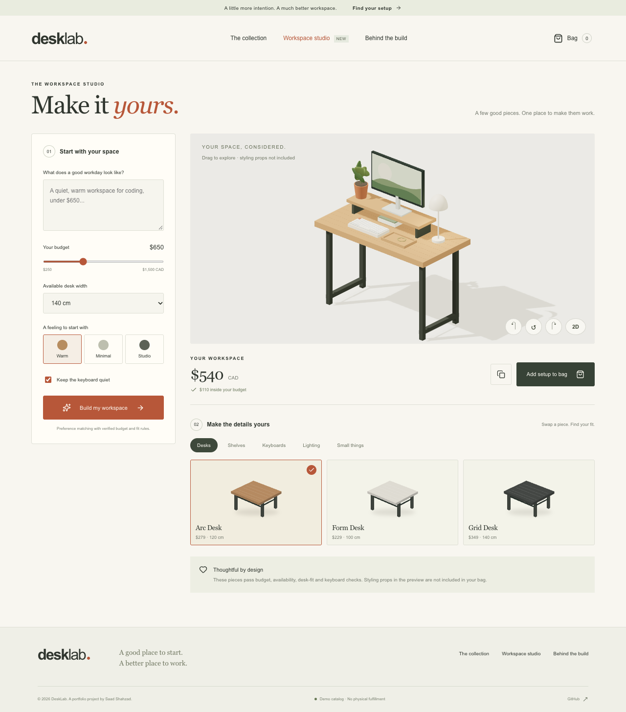
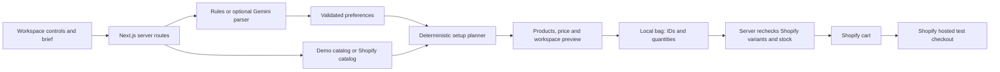

# DeskLab

An interactive workspace builder and headless Shopify storefront. Describe your space, budget and style, explore an original desk collection in 3D, and assemble a setup that passes the same fit checks whether it is recommended or customized by hand.

**Next.js · TypeScript · React Three Fiber · Shopify Storefront API · Playwright**

DeskLab is a portfolio demonstration by Saad Shahzad. Its 18 products are fictional, test orders do not represent stocked goods, and there is no physical fulfillment.

[Architecture and tradeoffs](docs/ARCHITECTURE.md) · [Portfolio walkthrough and resume bullets](docs/PORTFOLIO.md)

## Preview

The storefront presents the original collection around an interactive workspace scene.


The builder combines a visual preview with editable preferences, product choices and fit checks.



<details>
<summary>Mobile storefront</summary>


</details>

## What to try

- Open `/builder` and describe a warm, quiet workspace under $650.
- Change the width or budget and generate a new setup.
- Swap individual pieces, inspect dimensions and explore the 3D scene.
- Copy a workspace link and reopen it in another browser.
- Add pieces to the bag, change quantities and reload to check persistence.
- With a test Shopify store connected, continue to Shopify's hosted checkout.

All prices are CAD. Budgets cover products before tax and shipping. The fit model checks published rectangular footprints in a fixed two-row layout with 4 cm clearance. It does not assess ergonomics, structural load ratings, electrical compatibility or arbitrary room geometry.

## Verification status

Verification snapshot, November 15, 2026:

| Area                 | Evidence                                                                                                                                  |
| -------------------- | ----------------------------------------------------------------------------------------------------------------------------------------- |
| Domain and backend   | 46 automated tests passed                                                                                                                 |
| Browser flows        | 11 Playwright tests passed, including desktop/mobile navigation, real WebGL rotation, static fallback, cart persistence and shared setups |
| Live Shopify catalog | All 18 original products loaded through the Storefront API                                                                                |
| Live Shopify cart    | Cart creation returned a Shopify hosted checkout URL                                                                                      |
| Hosted test checkout | Completed a test order through Shopify's Test Payment Gateway; also verified a declined-payment error                                     |
| Live AI              | Intentionally deferred; the working demo uses rule-based brief parsing                                                                    |
| Public hosting       | Not deployed yet                                                                                                                          |

The automated service tests use Shopify and Gemini test doubles. The browser suite runs the real local recommendation route against demo fixtures, without live commerce credentials. Separate live integration checks loaded the catalog, created a cart, displayed a declined-payment error and confirmed a completed test checkout. Admin order inspection and a post-order inventory decrement were not verified. No real charge or physical fulfillment occurred. CI checks code; it does not deploy the app or place orders.

## Stack and data flow

| Layer                | Implementation                                                                   |
| -------------------- | -------------------------------------------------------------------------------- |
| Storefront           | Next.js 16 App Router, React, TypeScript                                         |
| Visuals              | Three.js and React Three Fiber, plus SVG product illustrations                   |
| Planning             | Deterministic constrained search over the catalog                                |
| Brief interpretation | Optional Gemini structured output with a rule-based fallback                     |
| Commerce             | Shopify's Storefront API client and hosted checkout                              |
| State                | Local browser bag and versioned, validated configuration links                   |
| Checks               | Node test runner with `tsx`, Playwright, ESLint, TypeScript and production build |



The current demo interprets briefs with rules. The optional AI path can interpret preferences; it never supplies product IDs, prices or purchase actions. The planner selects catalog entries, and checkout resolves IDs against a fresh Shopify catalog. Client-supplied prices, unknown products, duplicate cart lines and invalid quantities are rejected.

## Run locally

Use **Node.js 24** and **pnpm 11.25.0**, matching `package.json` and CI.

```sh
git clone https://github.com/Saadullah-2004/desklab.git
cd desklab
pnpm install --frozen-lockfile
cp .env.example .env.local
pnpm dev
```

Open [localhost:3000](http://localhost:3000). With both Shopify variables blank, the application uses its labeled demo catalog and disables checkout. No Shopify or model account is required to explore the builder.

For a production build:

```sh
pnpm build
pnpm start
```

## Connect a Shopify test store

1. Select a dedicated test store and configure its currency and Canadian market for CAD.
2. Install Shopify's **Headless** sales channel and create a storefront. Copy its **public Storefront access token**. This application keeps the token on the server, but it must be the public token type, not an Admin API token or private delegate token.
3. Enable product access and `unauthenticated_read_product_inventory`, needed for `quantityAvailable`.
4. Set `SHOPIFY_STORE_DOMAIN` to the bare `your-store.myshopify.com` domain, without a URL scheme or path. Set `SHOPIFY_STOREFRONT_ACCESS_TOKEN` in `.env.local`.
5. Seed products as described below, or create products with the exact handles in `src/lib/catalog.ts`. Publish them to the Headless publication. Mapping expects exactly one variant per product; extra variants require an explicit `shopifyVariantId` mapping.
6. Configure shipping from the inventory location and activate Shopify's Test gateway or Shopify Payments test mode. Verify the payment configuration in Shopify admin before setting `SHOPIFY_TEST_CHECKOUT_ENABLED=true`.
7. Restart the server and verify `/api/catalog` reports `source: "shopify"` and `checkoutEnabled: true`. Complete a test checkout and check the order, totals and inventory in Shopify admin.

The checkout flag defaults to false. Credentials alone enable catalog access, not checkout. The flag is an explicit operator attestation of test payment settings; the Storefront API does not verify the gateway configuration. Disable the flag before changing payment providers or taking the store out of test mode.

Storefront and Admin GraphQL requests use API version `2026-10`. Keep the version and SDK current together, and rerun integration checks when upgrading.

Partial configuration reports an error. A configured Shopify failure never silently substitutes demo merchandise. Missing or unpublished products are not presented as purchasable live products.

References: [Storefront authentication](https://shopify.dev/docs/storefronts/headless/building-with-the-storefront-api), [cart and checkout](https://shopify.dev/docs/storefronts/headless/building-with-the-storefront-api/cart/manage), [payment test mode](https://help.shopify.com/en/manual/checkout-settings/test-orders/payments-test-mode).

### Seed the original catalog

For a one-location test store, a CSV import can provision the products without an Admin API token:

```sh
node --import tsx scripts/shopify-export-csv.ts
```

Import `artifacts/shopify-products.csv` through Shopify admin's Products import. The file contains all 18 original handles, CAD prices, category tags, one default variant, tracked quantities of 20 for available fixtures and zero for the two unavailable fixtures. It leaves Online Store publication off. Publish the imported products to the intended Headless publication separately. Inventory quantity imports apply to a store with a single location; use Shopify's inventory workflow for multiple locations. Avoid enabling overwrite when importing into a store with existing merchandise.

The Admin API script below offers an alternative that preserves existing DeskLab prices and inventory on repeated runs.

The seed script is separate from the web application. Its default mode prints a local plan without network requests:

```sh
node --import tsx scripts/shopify-seed.ts
```

Create a scoped app through Shopify's supported developer flow and obtain an Admin API token for the dedicated test store. Put it in local `SHOPIFY_ADMIN_ACCESS_TOKEN`. Access required: `read_products`, `write_products`, `read_locations`, `write_inventory`, `read_publications`, `write_publications`.

Read setup IDs without changing the store:

```sh
node --env-file=.env.local --import tsx scripts/shopify-seed.ts --inspect
```

Set `SHOPIFY_SEED_LOCATION_ID` to an active inventory location and `SHOPIFY_PUBLICATION_ID` to the intended **Headless storefront publication**, then apply:

```sh
node --env-file=.env.local --import tsx scripts/shopify-seed.ts --apply
```

The script creates missing handles with tracked inventory, 20 units for available products and zero for unavailable ones. It stores the original specification in a JSON metafield and publishes only to the selected channel. Existing DeskLab products keep prices and inventory. Unrelated handle conflicts stop the script instead of overwriting products. Retrying a partial run does not replenish already-created stock.

The storefront runtime does not use the Admin token. Keep it out of deployment environments. See [API authentication](https://shopify.dev/docs/api/usage/authentication), [productSet](https://shopify.dev/docs/api/admin-graphql/2026-10/mutations/productSet) and [product publishing](https://shopify.dev/docs/api/admin-graphql/2026-10/mutations/publishablePublish).

## Enable live brief interpretation

Live AI is deferred for this release. Rule-based parsing and the full setup planner work without a provider key. The optional Gemini integration is implemented and tested with mocked responses, but has not been validated against the live provider. If enabling it later, configure all these server variables:

| Variable                   | Purpose                                                              |
| -------------------------- | -------------------------------------------------------------------- |
| `ENABLE_LIVE_AI=true`      | Explicitly enables model calls                                       |
| `GEMINI_API_KEY`           | Gemini API credential                                                |
| `GEMINI_MODEL`             | Structured-output model; example defaults to `gemini-3.5-flash-lite` |
| `UPSTASH_REDIS_REST_URL`   | HTTPS Upstash Redis REST endpoint                                    |
| `UPSTASH_REDIS_REST_TOKEN` | Shared limiter credential                                            |

A key alone never enables paid calls. An atomic Redis counter allows at most **5 model requests per minute and 50 per UTC day across all server instances**. These are request caps, not a billing guarantee. Calls have an 8-second timeout, bounded output and no paid retries. Limiter, model and validation failures fall back to rules and report that engine.

The application does not log briefs or model responses. With live AI enabled, Google receives the brief and selected defaults. Redis stores aggregate counters without prompts or IP addresses. Keep personal information out of demo briefs. Provider pricing and data handling depend on the configured accounts.

See [Gemini structured outputs](https://ai.google.dev/gemini-api/docs/structured-output) and [Upstash Redis](https://upstash.com/docs/redis/overall/getstarted).

## API contracts

| Route                 | Request                          | Response                                                                                       |
| --------------------- | -------------------------------- | ---------------------------------------------------------------------------------------------- |
| `GET /api/catalog`    | None                             | `products`, `source`, `checkoutEnabled`                                                        |
| `POST /api/recommend` | `brief`, optional `preferences`  | Recommendation plus `engine`, `notices`, `catalogSource`, `catalogSnapshot`, `checkoutEnabled` |
| `POST /api/checkout`  | `lines: [{productId, quantity}]` | Shopify `checkoutUrl`                                                                          |

Preferences contain integer `budgetCents`, numeric `deskWidthCm`, `style` (`warm`, `minimal`, `studio`) and boolean `quiet`. POST bodies are limited to 8 KiB, and briefs to 1,000 characters. Conflicting browser origins are rejected. Responses use `Cache-Control: no-store`.

Errors return `{ "error": "..." }` with an appropriate status. Checkout rechecks stock, then refuses Shopify warnings or altered line quantities. Final shipping, tax and payment validation happen in Shopify checkout. The application never collects card details.

## Checks and CI

```sh
pnpm lint
pnpm typecheck
pnpm test
pnpm build
```

Tests use the `react-server` condition for server-only modules. They require no production credentials and make no paid model requests.

The browser suite starts an isolated Next.js server on port 3001 with commerce credentials blank and live AI disabled. It uses installed Google Chrome locally:

```sh
pnpm test:e2e
```

To use Playwright's Chromium instead:

```sh
pnpm exec playwright install chromium
PLAYWRIGHT_CHANNEL=chromium pnpm test:e2e
```

GitHub Actions runs a frozen-lockfile install, code checks, a production build and the Chromium browser suite on pushes and pull requests. Failure traces and screenshots are uploaded as temporary CI artifacts. Before calling a connected deployment verified, also complete a test order and inspect it in Shopify admin. Automated tests do not verify payment or shipping configuration.

To refresh the documentation screenshots from the isolated demo browser tests:

```sh
UPDATE_SCREENSHOTS=1 pnpm test:e2e
```

This writes the homepage desktop/mobile views and workspace builder to `docs/screenshots/`. Review the images before committing them. Ordinary test runs leave the documentation images unchanged.

## Deployment

Use a host supporting Next.js server routes and Node.js 24, such as Vercel or a Node server. Static export is unsuitable because recommendation and checkout routes run on the server. Configure environment variables in the host, build with `pnpm build`, and use its Next.js runtime or `pnpm start`.

Start with AI disabled and both Shopify variables blank for a no-checkout preview. Configure integrations separately and verify them from the deployed origin. Never prefix server credentials with `NEXT_PUBLIC_`, commit `.env.local`, or expose the Admin token to the browser. [.env.example](.env.example) documents configuration.

A public frontend does not remove checkout restrictions on an underlying Shopify dev store. See [dev-store limits](https://shopify.dev/docs/apps/build/stores/development-stores) and [Next.js deployment](https://nextjs.org/docs/app/getting-started/deploying).

## Source map

- `src/components/desklab.tsx`: storefront, builder and bag.
- `src/components/workspace-scene.tsx`: interactive preview.
- `src/lib/catalog.ts`: original products and dimensions.
- `src/lib/recommend.ts`: planning and brief fallback.
- `src/lib/configuration.ts`: shared configurations and cart validation.
- `src/lib/shopify.ts`: live catalog and checkout.
- `src/lib/ai.ts`: optional extraction and spending controls.
- `src/app/api/`: bounded server endpoints.
- `scripts/shopify-seed.ts`: explicit provisioning.
- `tests/` and `src/lib/*.test.ts`: domain and backend checks.
