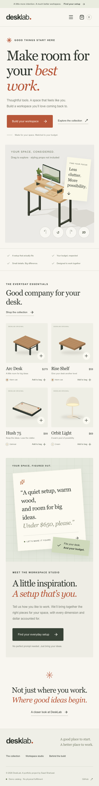
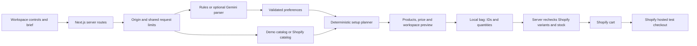

# DeskLab

An interactive workspace builder and headless Shopify storefront. Describe your space, budget and style, explore an original desk collection in 3D, and assemble a setup that passes the same fit checks whether it is recommended or customized by hand.

**Next.js · TypeScript · React Three Fiber · Shopify Storefront API · Playwright**

DeskLab is a portfolio demonstration by Saad Shahzad. Its 18 products are fictional, test orders do not represent stocked goods, and there is no physical fulfillment.

[Architecture and tradeoffs](docs/ARCHITECTURE.md) · [Portfolio walkthrough and resume bullets](docs/PORTFOLIO.md)

## Preview

The storefront presents the original collection around an interactive workspace scene.


The builder combines a visual preview with editable preferences, product choices and fit checks.


<details>
<summary>Mobile storefront</summary>



</details>

## What to try

- Open `/builder` and describe a warm, quiet workspace under $650.
- Change the width or budget and generate a new setup.
- Swap individual pieces, inspect dimensions and explore the 3D scene.
- Copy a workspace link and reopen it in another browser.
- Add pieces to the bag, change quantities and reload to check persistence.
- With a test Shopify store connected, continue to Shopify's hosted checkout.

All prices are CAD. Budgets cover products before tax and shipping. The fit model checks published rectangular footprints in a fixed two-row layout with 4 cm clearance. It does not assess ergonomics, structural load ratings, electrical compatibility or arbitrary room geometry.

## Verification status

Verification snapshot, November 15, 2026:

| Area                 | Evidence                                                                                                                                            |
| -------------------- | --------------------------------------------------------------------------------------------------------------------------------------------------- |
| Domain and backend   | Full suite: 105/105 tests passed                                                                                                                    |
| Browser flows        | Production Chromium/WebKit suite: 31 passed; one engine-specific pixel check intentionally skipped                                                  |
| Production build     | Succeeded as part of the browser suite                                                                                                              |
| Dependency audit     | `pnpm audit --prod` reported no known vulnerabilities                                                                                               |
| Live Shopify catalog | All 18 original products loaded through the Storefront API                                                                                          |
| Live Shopify cart    | Cart creation returned a Shopify hosted checkout URL                                                                                                |
| Hosted test checkout | Completed a test order through Shopify's Test Payment Gateway; also verified a declined-payment error                                               |
| Brief evaluation     | Offline rules: 12/12 exact preferences, 48/48 fields and 12/12 constraint checks on the public synthetic regression set                             |
| Live AI              | Not yet verified; Gemini free-project setup and live evaluation are pending                                                                         |
| Shared Redis         | Personal Upstash $0 Free database created without a payment method; authenticated PING and the application's live limiter EVAL allow path succeeded |
| Public hosting       | Personal Vercel workspace verified as Hobby and signed in; repository connection and deployment remain pending                                      |

The automated service tests use Shopify, Redis and Gemini test doubles. The browser suite runs the real local recommendation route against demo fixtures, without live commerce credentials. Separate live integration checks loaded the catalog, created a cart, displayed a declined-payment error and confirmed a completed test checkout. Admin order inspection and a post-order inventory decrement were not verified. No real charge or physical fulfillment occurred. CI checks code; it does not deploy the app or place orders. The 12-case rules evaluation is a regression check, not evidence of general language understanding or live model quality.

## Stack and data flow

| Layer                | Implementation                                                                                              |
| -------------------- | ----------------------------------------------------------------------------------------------------------- |
| Storefront           | Next.js 16 App Router, React, TypeScript                                                                    |
| Visuals              | Three.js and React Three Fiber, plus SVG product illustrations                                              |
| Planning             | Deterministic constrained search over the catalog                                                           |
| Brief interpretation | Optional Gemini structured output with a rule-based fallback                                                |
| Commerce             | Shopify's Storefront API client and hosted checkout                                                         |
| State                | Local browser bag and versioned, validated configuration links                                              |
| Request protection   | Shared Upstash Redis quotas, canonical origin checks and bounded request bodies                             |
| Discovery and health | Per-page canonical/social metadata, generated share image, robots, sitemap and a minimal readiness endpoint |
| Checks               | Node test runner with `tsx`, Playwright, ESLint, TypeScript and production build                            |



The current demo interprets briefs with rules. The optional AI path can interpret preferences; it never supplies product IDs, prices or purchase actions. The planner selects catalog entries, and checkout resolves IDs against a fresh Shopify catalog. Client-supplied prices, unknown products, duplicate cart lines and invalid quantities are rejected.

## Run locally

Use **Node.js 24** and **pnpm 11.25.0**, matching `package.json` and CI.

```sh
git clone https://github.com/Saadullah-2004/desklab.git
cd desklab
pnpm install --frozen-lockfile
cp .env.example .env.local
pnpm dev
```

Open [localhost:3000](http://localhost:3000). With both Shopify variables blank, the application uses its labeled demo catalog and disables checkout. No Shopify or model account is required to explore the builder.

For a local production build, explicitly use the loopback-only memory limiter:

```sh
APP_ORIGIN=http://127.0.0.1:3000 RATE_LIMIT_BACKEND=memory pnpm build
APP_ORIGIN=http://127.0.0.1:3000 RATE_LIMIT_BACKEND=memory pnpm start
```

Open `http://127.0.0.1:3000` for that run. Public production requires the shared Redis configuration below. It never falls back to per-process memory. Partial Redis configuration fails closed even in development.

## Connect a Shopify test store

1. Select a dedicated test store and configure its currency and Canadian market for CAD.
2. Install Shopify's **Headless** sales channel and create a storefront. Copy its **public Storefront access token**. This application keeps the token on the server, but it must be the public token type, not an Admin API token or private delegate token.
3. Enable product access and `unauthenticated_read_product_inventory`, needed for `quantityAvailable`.
4. Set `SHOPIFY_STORE_DOMAIN` to the bare `your-store.myshopify.com` domain, without a URL scheme or path. Set `SHOPIFY_STOREFRONT_ACCESS_TOKEN` in `.env.local`.
5. Seed products as described below, or create products with the exact handles in `src/lib/catalog.ts`. Publish them to the Headless publication. Mapping expects exactly one variant per product; extra variants require an explicit `shopifyVariantId` mapping.
6. Configure shipping from the inventory location and activate Shopify's Test gateway or Shopify Payments test mode. Verify the payment configuration in Shopify admin before setting `SHOPIFY_TEST_CHECKOUT_ENABLED=true`.
7. Restart the server and verify `/api/catalog` reports `source: "shopify"` and `checkoutEnabled: true`. Complete a test checkout and check the order, totals and inventory in Shopify admin.

The checkout flag defaults to false. Credentials alone enable catalog access, not checkout. The flag is an explicit operator attestation of test payment settings; the Storefront API does not verify the gateway configuration. Disable the flag before changing payment providers or taking the store out of test mode.

Storefront and Admin GraphQL requests use API version `2026-10`. Keep the version and SDK current together, and rerun integration checks when upgrading.

Partial configuration reports an error. A configured Shopify failure never silently substitutes demo merchandise. Missing or unpublished products are not presented as purchasable live products.

References: [Storefront authentication](https://shopify.dev/docs/storefronts/headless/building-with-the-storefront-api), [cart and checkout](https://shopify.dev/docs/storefronts/headless/building-with-the-storefront-api/cart/manage), [payment test mode](https://help.shopify.com/en/manual/checkout-settings/test-orders/payments-test-mode).

### Seed the original catalog

For a one-location test store, a CSV import can provision the products without an Admin API token:

```sh
node --import tsx scripts/shopify-export-csv.ts
```

Import `artifacts/shopify-products.csv` through Shopify admin's Products import. The file contains all 18 original handles, CAD prices, category tags, one default variant, tracked quantities of 20 for available fixtures and zero for the two unavailable fixtures. It leaves Online Store publication off. Publish the imported products to the intended Headless publication separately. Inventory quantity imports apply to a store with a single location; use Shopify's inventory workflow for multiple locations. Avoid enabling overwrite when importing into a store with existing merchandise.

The Admin API script below offers an alternative that preserves existing DeskLab prices and inventory on repeated runs.

The seed script is separate from the web application. Its default mode prints a local plan without network requests:

```sh
node --import tsx scripts/shopify-seed.ts
```

Create a scoped app through Shopify's supported developer flow and obtain an Admin API token for the dedicated test store. Put it in local `SHOPIFY_ADMIN_ACCESS_TOKEN`. Access required: `read_products`, `write_products`, `read_locations`, `write_inventory`, `read_publications`, `write_publications`.

Read setup IDs without changing the store:

```sh
node --env-file=.env.local --import tsx scripts/shopify-seed.ts --inspect
```

Set `SHOPIFY_SEED_LOCATION_ID` to an active inventory location and `SHOPIFY_PUBLICATION_ID` to the intended **Headless storefront publication**, then apply:

```sh
node --env-file=.env.local --import tsx scripts/shopify-seed.ts --apply
```

The script creates missing handles with tracked inventory, 20 units for available products and zero for unavailable ones. It stores the original specification in a JSON metafield and publishes only to the selected channel. Existing DeskLab products keep prices and inventory. Unrelated handle conflicts stop the script instead of overwriting products. Retrying a partial run does not replenish already-created stock.

The storefront runtime does not use the Admin token. Keep it out of deployment environments. See [API authentication](https://shopify.dev/docs/api/usage/authentication), [productSet](https://shopify.dev/docs/api/admin-graphql/2026-10/mutations/productSet) and [product publishing](https://shopify.dev/docs/api/admin-graphql/2026-10/mutations/publishablePublish).

## Brief interpretation and evaluation

The working demo currently uses rules. The optional Gemini integration has mocked failure-path coverage but has not been verified against a live provider. Rules recognize explicit CAD budgets, centimeters/meters, the documented palette keywords and quiet/clicky preferences. Structured controls remain available for unsupported or ambiguous language.

Live AI requires all the following server configuration:

| Variable                          | Purpose                                                                                 |
| --------------------------------- | --------------------------------------------------------------------------------------- |
| `ENABLE_LIVE_AI=true`             | Explicitly enables model calls after free-project verification                          |
| `GEMINI_FREE_TIER_CONFIRMED=true` | Operator attestation that the personal project is Free Tier with Cloud Billing disabled |
| `GEMINI_API_KEY`                  | Credential from that verified project                                                   |
| `GEMINI_MODEL`                    | Only `gemini-3.5-flash-lite` is accepted; other model names disable live extraction     |
| `UPSTASH_REDIS_REST_URL`          | HTTPS Upstash Redis REST endpoint                                                       |
| `UPSTASH_REDIS_REST_TOKEN`        | Shared limiter credential                                                               |

A key or confirmation flag cannot prove account billing settings. Verify them in the provider console. The reviewed model has free Standard-tier input/output, but the same model also has paid pricing. Keep this project on Free Tier with no linked Cloud Billing account. [Gemini pricing](https://aistudio.google.com/docs/pricing#gemini-3.5-flash-lite), [billing](https://aistudio.google.com/docs/billing).

An atomic Redis counter permits at most **5 model requests per minute and 50 per UTC day across instances**, after the recommendation route's own limits pass. Each call has an 8-second timeout, one candidate and a 512-token output limit. There are no retries, alternate providers or paid model fallbacks. An empty brief uses the selected controls without contacting Gemini. Model errors, quota exhaustion or invalid output return a truthfully labelled rules result. Provider quotas are project-specific and can be lower; Google's daily reset is Pacific time, separate from DeskLab's UTC counter. [Gemini rate limits](https://aistudio.google.com/docs/rate-limits).

Run the bounded offline evaluation without any provider requests:

```sh
pnpm eval:ai
```

The public fixtures in `scripts/ai-eval-cases.ts` originally scored 8/12 exact preferences and 43/48 fields. Adding the documented palette synonyms, metric-width conversion and a fix preventing “up to 1.2 meters” from becoming a $1.20 budget raised the same regression set to **12/12 exact, 48/48 fields**. Both runs passed 12/12 catalog, price, budget and fit checks. This small development set is not an independent benchmark or a live Gemini evaluation.

After verifying free-project billing and configuring the shared allowance, explicitly opt into a live evaluation:

```sh
node --env-file=.env.local --conditions=react-server --import tsx scripts/ai-eval.ts --live --limit=12
```

The script sends at most 12 requests, 15 seconds apart, with no retries; the same daily allowance applies. It records actual engines, exact and field matches, constraint checks and fallbacks in ignored `artifacts/` reports. Any live fallback, preference mismatch or constraint failure exits nonzero. A rules result never counts as a successful provider call.

## Privacy and request protection

With live AI enabled, Google receives the brief and selected preferences. Free-tier content may be used to improve Google products. The interface discloses this beside the brief and links to its privacy explanation. Use the structured controls without entering a brief to avoid that transfer, and keep personal information out of demo briefs. [Google data-use terms](https://aistudio.google.com/docs/terms).

Application logs contain only a fixed route name, HTTP status and duration. They exclude briefs, model responses, cart identifiers, URLs, credentials and raw IP addresses. Hosting-provider access logs have separate retention settings. Redis stores global counters and daily-rotated HMAC client identifiers, not raw IP addresses or prompts. Minute counters expire after 120 seconds and daily counters after 48 hours. The browser stores bag IDs/quantities; shared URLs store IDs and structured preferences, without free-text briefs or prices.

Public API limits are fixed windows, shared across server instances:

| Route          | Per client/minute | Global/minute | Global/UTC day |
| -------------- | ----------------: | ------------: | -------------: |
| Catalog        |                60 |           300 |            800 |
| Recommendation |                12 |            60 |            150 |
| Checkout       |                 5 |            20 |             50 |

`RATE_LIMIT_IP_HASH_SECRET` must be at least 32 characters. Vercel uses its trusted forwarded-client header. On another host, configure `RATE_LIMIT_CLIENT_IP_HEADER` only if the reverse proxy overwrites that header; otherwise callers share a conservative client allowance. These workload caps do not bound all provider usage: rejected traffic also reaches Redis, and hosting serves page and asset requests outside these route caps. Account-level free-plan settings remain essential.

## API contracts

| Route                 | Request                          | Response                                                                                       |
| --------------------- | -------------------------------- | ---------------------------------------------------------------------------------------------- |
| `GET /api/catalog`    | None                             | `products`, `source`, `checkoutEnabled`                                                        |
| `POST /api/recommend` | `brief`, optional `preferences`  | Recommendation plus `engine`, `notices`, `catalogSource`, `catalogSnapshot`, `checkoutEnabled` |
| `POST /api/checkout`  | `lines: [{productId, quantity}]` | Shopify `checkoutUrl`                                                                          |
| `GET /api/health`     | None                             | `status: "ok"` or `"unavailable"`, with HTTP 200 or 503                                        |

Preferences contain integer `budgetCents` from 100 to 1,000,000, numeric `deskWidthCm` from 60 to 300, `style` (`warm`, `minimal`, `studio`) and boolean `quiet`. POST bodies are limited to 8 KiB, and briefs to 1,000 characters. Conflicting browser origins are rejected against `APP_ORIGIN`. Responses use `Cache-Control: no-store`. Rate exhaustion returns 429 with `Retry-After`; unavailable shared protection returns 503 instead of running unprotected.

Health checks validate origin configuration and Redis reachability, with a 30-second per-instance probe cache. They do not fetch Shopify products, reserve an AI request or create a cart. A healthy response does not certify Shopify payments, model availability or free-plan billing. Response headers include a content security policy, framing restrictions, MIME sniffing protection, a no-referrer policy and production HSTS.

Errors return `{ "error": "..." }` with an appropriate status. Checkout rechecks stock, then refuses Shopify warnings or altered line quantities. Final shipping, tax and payment validation happen in Shopify checkout. The application never collects card details.

## Checks and CI

```sh
pnpm lint
pnpm typecheck
pnpm test
pnpm build
```

Tests use the `react-server` condition for server-only modules. They require no production credentials and make no paid model requests.

The browser suite builds and starts an isolated Next.js production server on port 3001 with commerce credentials blank and live AI disabled. It runs Chromium and WebKit projects, using installed Google Chrome for the Chromium project locally:

```sh
pnpm test:e2e
```

Install the browser engines, or use Playwright's Chromium instead of local Chrome:

```sh
pnpm exec playwright install chromium webkit
PLAYWRIGHT_CHANNEL=chromium pnpm test:e2e
```

GitHub Actions runs a frozen-lockfile install, code checks, a production build and the Chromium/WebKit browser suite on pushes and pull requests. Failure traces and screenshots are uploaded as temporary CI artifacts. Before calling a connected deployment verified, also complete a test order and inspect it in Shopify admin. Automated tests do not verify payment or shipping configuration.

After connecting Shopify, `pnpm smoke:public --url=https://YOUR-PROJECT.vercel.app` checks the homepage, production headers, readiness, all 18 live catalog entries and an empty-brief recommendation. It makes no Gemini calls or carts, and a demo-only catalog intentionally fails this connected-store check. The separate public-smoke workflow can run manually and has a scheduled check that remains skipped until the repository's `DESKLAB_PUBLIC_URL` variable is configured. No public URL is configured yet, so active monitoring has not been established.

To refresh the documentation screenshots from the isolated demo browser tests:

```sh
UPDATE_SCREENSHOTS=1 pnpm test:e2e
```

This writes the homepage desktop/mobile views and workspace builder to `docs/screenshots/`. Review the images before committing them. Ordinary test runs leave the documentation images unchanged.

## Free-only deployment runbook

No public deployment exists yet. The signed-in personal Vercel workspace is visibly on Hobby; the GitHub connection scoped to this repository and deployment remain pending. A personal Upstash $0 Free database has been created without adding a payment method, with credentials stored privately in local configuration. Authenticated PING and the application's actual limiter EVAL allow path succeeded. This verifies live Redis connectivity and one allowed reservation, not deployed application readiness or exhaustion behavior. Gemini setup/live evaluation remain pending. Use personal accounts and the free plans below; do not add a payment method, enable paid trials/add-ons or buy a domain for this portfolio demo.

1. **Hosting:** select Vercel **Hobby**, verify the account has no paid subscription/payment method, and use the included `.vercel.app` address. Keep this as a personal noncommercial demo. If Hobby limits are exhausted, wait for service to resume or pause the deployment instead of upgrading. [Hobby plan](https://vercel.com/docs/plans/hobby).
2. **Request protection:** create or select an Upstash **Free** database in an account with no payment method. Verify it is not Pay as You Go or a paid fixed plan. Adding a payment method automatically upgrades all free resources in that Upstash account, and an account with a payment method cannot keep or create Free databases. Do not add a card or paid add-ons. [Upstash upgrade rules](https://upstash.com/docs/redis/howto/upgrade-database).
3. **Server configuration:** set `APP_ORIGIN` to the exact public HTTPS origin, and configure `UPSTASH_REDIS_REST_URL`, `UPSTASH_REDIS_REST_TOKEN` and a generated `RATE_LIMIT_IP_HASH_SECRET`. Set these before building. Use Node.js 24 and the repository's frozen lockfile. Static export is unsuitable because the API routes require a server.
4. **First deployment:** leave `ENABLE_LIVE_AI=false`, `GEMINI_FREE_TIER_CONFIRMED=false` and `SHOPIFY_TEST_CHECKOUT_ENABLED=false`. Build and verify all four pages, `/api/health`, catalog/recommendation requests, mobile navigation, sharing and the bag from the deployed origin. Keep all credentials server-side and the Admin token out of hosting environments.
5. **Test commerce:** connect the dedicated Shopify test store, verify its test payment gateway in admin, then enable the checkout attestation and repeat successful/declined test payments from the deployed site. Inspect the order and inventory separately before claiming those checks passed. Do not upgrade the Shopify plan or enable real payments for this demo.
6. **Optional live AI:** create a dedicated personal Gemini project and verify **Free Tier** in AI Studio, with Cloud Billing disabled and no linked billing account/payment method for that project. Check its actual model quotas. Only then set the AI confirmation/enable flags and run the bounded live evaluation above. If setup requires paid billing, leave live AI disabled and use rules. [Gemini billing](https://aistudio.google.com/docs/billing).
7. **Record evidence:** update this status table only after observing the deployed result. Record the URL, tested revision, provider account tiers, test outcomes and remaining limits without publishing secrets or customer data.

Under quota exhaustion, preserve the free-only constraint: Gemini falls back to rules; the API limiter returns 429 or 503 and does not switch to memory in public production. If hosting or Redis remains exhausted, pause the deployment or wait for the free quota to reset. Disabling live AI does not bypass API protection. There is no paid fallback in the application, and code-level caps cannot verify or lock external billing settings.

Each page has a canonical URL and a truthful social description. `/opengraph-image` generates the original share card locally; `/sitemap.xml` lists only the four public routes. `/robots.txt` excludes API routes. Missing/invalid origins, local builds and Vercel preview/development deployments are noindex and publish no sitemap entries. `APP_ORIGIN` is used at build time, so rebuild after changing it.

Never prefix server credentials with `NEXT_PUBLIC_` or commit `.env.local`. [.env.example](.env.example) documents configuration. A public frontend does not remove an underlying Shopify dev store's checkout restrictions. See [dev-store limits](https://shopify.dev/docs/apps/build/stores/development-stores) and [Next.js deployment](https://nextjs.org/docs/app/getting-started/deploying).

## Source map

- `src/components/desklab.tsx`: storefront, builder and bag.
- `src/components/workspace-scene.tsx`: interactive preview.
- `src/lib/catalog.ts`: original products and dimensions.
- `src/lib/recommend.ts`: planning and brief fallback.
- `src/lib/configuration.ts`: shared configurations and cart validation.
- `src/lib/shopify.ts`: live catalog and checkout.
- `src/lib/ai.ts`: gated extraction and shared model allowance.
- `src/lib/rate-limit.ts`, `server-config.ts`, `observability.ts`: request protection and sanitized diagnostics.
- `src/app/_metadata.ts` and metadata routes: canonicals, sharing and indexing policy.
- `src/app/api/`: bounded server endpoints.
- `scripts/shopify-seed.ts`: explicit provisioning.
- `scripts/ai-eval.ts`: bounded rules/live evaluation over public fixtures.
- `tests/` and `src/lib/*.test.ts`: domain and backend checks.
